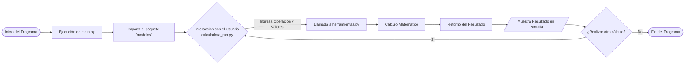

# 🧮 Proyecto: Calculadora Modular en Python

Este repositorio contiene el código fuente de una calculadora desarrollada en Python para un trabajo de programación. El proyecto está estructurado de manera modular, separando la lógica de ejecución principal de las herramientas y operaciones matemáticas.

## 📁 Estructura del Proyecto

El proyecto sigue una arquitectura limpia basada en módulos:

```text
📁 /
├── 📄 main.py                  # Punto de entrada principal de la aplicación.
└── 📁 modelos/                 # Paquete que contiene la lógica interna.
    ├── 📄 __init__.py          # Archivo de inicialización del paquete.
    ├── 📄 calculadora_run.py   # Controlador principal de los flujos de la calculadora.
    └── 📄 herramientas.py      # Funciones matemáticas y utilidades.
```

## 🚀 Funcionalidad

El programa sirve como una calculadora interactiva. Al ejecutar el archivo principal (`main.py`), se invoca la lógica contenida en `calculadora_run.py`, la cual a su vez hace uso de las funciones y operaciones específicas definidas en `herramientas.py`. Esto permite que el código sea escalable, fácil de leer y de mantener.

## 🛠️ Instalación y Requisitos

Para que este proyecto funcione correctamente en tu entorno local, asegúrate de tener Python instalado (versión 3.6 o superior). 

Si tu proyecto requiere dependencias externas o módulos adicionales, puedes instalarlos ejecutando el siguiente comando en tu terminal (asegúrate de estar en la carpeta del proyecto):

```bash
pip install -r requirements.txt
```
*(Nota: Si usaste librerías estándar como `math`, no es necesaria ninguna instalación adicional, pero este comando cubre cualquier módulo extra que el profesor evalúe).*

## 💻 Instrucciones de Uso

Para iniciar la calculadora, simplemente abre tu terminal o consola de comandos, navega hasta el directorio del proyecto y ejecuta:

```bash
python main.py
```
## 🪞 Imágenes

<p align="center">
  
</p>

## 📊 Diagrama de Flujo

A continuación, se detalla el flujo de ejecución del programa.



## 🎓 Sobre el Trabajo
Este proyecto fue creado como parte de una evaluación académica de programación, demostrando conocimientos en:
* Importación y creación de módulos en Python.
* Lógica algorítmica y modularidad.
* Interacción con el usuario por consola.
