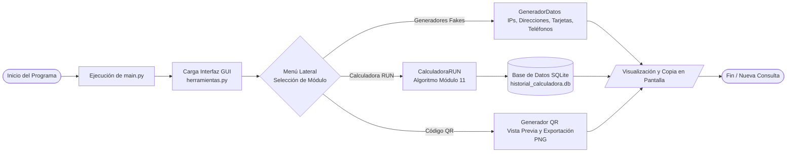

# 🛠️ Proyecto: KDZ Tools v2.0 — Suite Modular con Interfaz Gráfica en Python

Este repositorio contiene el código fuente de una aplicación de escritorio desarrollada en Python para un trabajo de programación. El proyecto mantiene una arquitectura limpia y modular, separando el punto de entrada principal de la interfaz gráfica (`CustomTkinter`), los generadores de datos de prueba, el generador de códigos QR y la calculadora de RUN con persistencia en base de datos SQLite.

## 📁 Estructura del Proyecto

El proyecto sigue una arquitectura limpia basada en módulos:

```text
📁 /
├── 📄 main.py                          # Punto de entrada principal de la aplicación gráfica.
├── 📄 requirements.txt                 # Dependencias externas del proyecto.
├── 📄 README.md                        # Documentación general del repositorio.
└── 📁 modelos/                         # Paquete que contiene toda la lógica y vistas internas.
    ├── 📄 __init__.py                  # Archivo de inicialización y exportación del paquete.
    ├── 📄 calculadora_run.py           # Algoritmo Módulo 11 y persistencia en SQLite.
    ├── 📄 herramientas.py              # Lógica de generadores, QR e interfaz gráfica (GUI).
    └── 📄 historial_calculadora.db     # Base de datos SQLite autogenerada con el historial de RUN.
```

## 🚀 Funcionalidad

Al ejecutar el archivo principal (`main.py`), se despliega una interfaz gráfica moderna (con soporte para **Modo Oscuro y Modo Claro**) que integra todas las utilidades del sistema en un único panel lateral:

* **🌐 Generadores de Datos Ficticios (Testing y QA):**
  * **Direcciones IP:** Generación de direcciones IPv4 aleatorias.
  * **Direcciones:** Creación de direcciones postales ficticias.
  * **User-Agents:** Cadenas de navegadores y sistemas operativos variados.
  * **Tarjetas Fakes:** Generación de tarjetas **Visa** y **MasterCard** con titular, fecha de vencimiento, dirección y código CVV.
  * **Teléfonos por País:** Números móviles con formato válido para **Chile, España, Perú, Colombia** o modo aleatorio mezclado.
  * *Incluye generación por lotes y copiado rápido al portapapeles con un clic.*

* **🪪 Calculadora de RUN Chileno (Módulo 11 + SQLite):**
  * Calcula automáticamente el dígito verificador (`0-9` o `K`), formatea el resultado con puntos y guion, y almacena cada consulta en `historial_calculadora.db` con visualización y limpieza del historial en tiempo real.

* **🔳 Generador de Códigos QR:**
  * Convierte cualquier texto o enlace URL en un código QR con **vista previa instantánea** en pantalla y exportación directa a imagen `.png` de alta resolución.

## 🛠️ Instalación y Requisitos

Para que este proyecto funcione correctamente en tu entorno local, asegúrate de tener Python instalado (**versión 3.8 o superior**).

Instala todas las dependencias necesarias (`customtkinter`, `Pillow`, `pyqrcode`, `pypng` y `Faker`) ejecutando el siguiente comando en tu terminal dentro de la carpeta del proyecto:

```bash
pip install -r requirements.txt
```

## 💻 Instrucciones de Uso

Para iniciar la aplicación con interfaz gráfica, abre tu terminal o consola de comandos, navega hasta el directorio del proyecto y ejecuta:

```bash
python main.py
```

## 🪞 Imágenes

<p align="center">
  

</p>

## 📊 Diagrama de Flujo

A continuación, se detalla el flujo de ejecución y arquitectura de la aplicación.



## 🎓 Sobre el Trabajo

Este proyecto fue creado como parte de una evaluación académica de programación, demostrando conocimientos en:

* Importación, encapsulamiento y creación de paquetes modulares en Python (`modelos`).
* Desarrollo de interfaces gráficas modernas de escritorio mediante `CustomTkinter`.
* Persistencia de datos local utilizando bases de datos relacionales con `SQLite3`.
* Lógica algorítmica (cálculo de dígito verificador Módulo 11), manejo de imágenes en memoria y generación de datos sintéticos.
