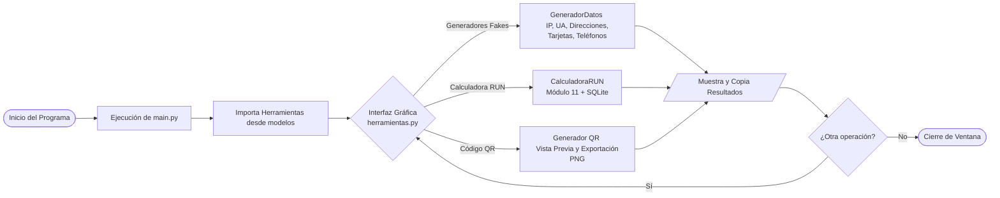

# 🧰 Proyecto: Suite de Herramientas y Calculadora RUN en Python (GUI)

Este repositorio contiene el código fuente de una aplicación de escritorio desarrollada en Python con interfaz gráfica moderna (**CustomTkinter**). El proyecto está estructurado de manera modular, separando la ventana principal, la generación de datos de prueba, la creación de códigos QR y la lógica de cálculo y persistencia SQLite.

## 📁 Estructura del Proyecto

El proyecto sigue una arquitectura limpia basada en módulos:

```text
📁 /
├── 📄 main.py                  # Punto de entrada principal de la aplicación.
├── 📄 requirements.txt         # Dependencias externas del proyecto.
├── 📄 README.md                # Documentación general del repositorio.
└── 📁 modelos/                 # Paquete que contiene la lógica interna e interfaz.
    ├── 📄 __init__.py          # Archivo de inicialización del paquete (vacío).
    ├── 📄 calculadora_run.py   # Algoritmo Módulo 11 y persistencia en SQLite.
    └── 📄 herramientas.py      # Interfaz gráfica (GUI), generadores y creador QR.
```

## 🚀 Funcionalidad

Al ejecutar `main.py`, se inicia la interfaz gráfica con navegación lateral organizada en dos módulos principales:

- **Generadores de Datos de Prueba:** Generación configurable en lote (con opción de copiado rápido al portapapeles) de direcciones IPv4, cadenas User-Agent, direcciones postales, tarjetas de prueba (Visa / MasterCard) y números telefónicos con formato válido para Chile, España, Perú y Colombia.
- **Calculadora de Dígito Verificador (RUN):** Calcula el dígito verificador mediante el algoritmo Módulo 11, formatea el resultado automáticamente y almacena cada consulta en una base de datos local SQLite (`historial_calculadora.db`) con visualización y limpieza de historial desde la misma ventana.
- **Generador de Códigos QR:** Convierte texto o enlaces URL en códigos QR con vista previa instantánea dentro de la interfaz y exportación directa a archivo `.png`.

## 🛠️ Instalación y Requisitos

Para que este proyecto funcione correctamente en tu entorno local, asegúrate de tener Python instalado (versión 3.10 o superior) e instala las dependencias ejecutando el siguiente comando dentro de la carpeta del proyecto:

```bash
pip install -r requirements.txt
```

## 💻 Instrucciones de Uso

Para iniciar la aplicación con interfaz gráfica, abre tu terminal o consola de comandos, navega hasta el directorio del proyecto y ejecuta:

```bash
python main.py
```

## 🎴 Imágenes

<p align="center">
  
</p>

## 📊 Diagrama de Flujo

A continuación, se detalla el flujo de ejecución del programa:



## 🎓 Sobre el Trabajo
Este proyecto fue creado como parte de una evaluación académica de programación, demostrando conocimientos en:
- Importación y creación de paquetes y módulos en Python.
- Lógica algorítmica (Módulo 11) y persistencia de datos con SQLite.
- Desarrollo de interfaces gráficas de usuario modernas y programación orientada a objetos.

---

<div align="center">
  <br />
  <strong>Creado por aburrimiento</strong> · VicenteRC-Dev
</div>
